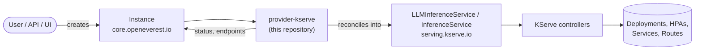

# KServe Provider

> [!WARNING]
> **Pre-alpha.** OpenEverest v2 and this provider are under active development. CRD schemas,
> chart values and defaults change frequently, including in breaking ways, and there is no
> supported upgrade path between versions yet. Not for production use.

<!-- Remove the pre-alpha banner and the status badge at v2 GA. -->

[](https://github.com/openeverest/openeverest)
[](https://github.com/openeverest/provider-kserve/releases)
[](https://github.com/openeverest/provider-kserve/actions/workflows/build.yaml)
[](https://pkg.go.dev/github.com/openeverest/provider-kserve)
[](LICENSE)

Serve **Large Language Models and predictive models** on Kubernetes through
[OpenEverest](https://github.com/openeverest/openeverest), backed by
[KServe](https://kserve.github.io/website/).

## What this is

OpenEverest providers translate a single, technology-agnostic `Instance` custom resource into
the native custom resources of an upstream Kubernetes operator — for databases, but equally
for caches, message queues, object storage, or model-serving runtimes. This repository is the
provider for **KServe**: it owns the technology-specific knowledge — topologies, versions,
parameters, gateway wiring — so that users, the API server, and the UI stay
technology-agnostic.

> [!IMPORTANT]
> **This provider is not standalone.** It requires an OpenEverest installation (core CRDs and
> controller) in the cluster. Installing this chart on its own does nothing.
> See [Install OpenEverest](https://openeverest.io/documentation/current/quick-install.html).



The provider watches `Instance` resources whose `spec.providerRef.name` is `provider-kserve`,
and reports workload health back onto `Instance.status`. It never manages pods directly — all
lifecycle work is delegated to the KServe controllers. Everything is created in
KServe's **Standard** mode (plain Deployments plus HPA, no Knative dependency); KServe
formerly called this mode `RawDeployment`.

## Compatibility

Releases and their changelogs are on
[GitHub Releases](https://github.com/openeverest/provider-kserve/releases); `helm install`
without `--version` takes the latest.

| provider-kserve | OpenEverest | KServe | Kubernetes |
|---|---|---|---|
| `0.4.x` | `>= 2.0.0-dev.4` | `0.21.0` | `1.30` – `1.36` |
| `0.2.3` – `0.3.0` | `>= 2.0.0-dev.4` | `0.21.0-rc1` | `1.30` – `1.36` |
| `0.2.0` – `0.2.2` | `>= 2.0.0-dev.2` | `0.21.0-rc1` | `1.30` – `1.36` |
| `0.1.x` | `>= 2.0.0-dev.2` | `0.20.0` | `1.30` – `1.34` |

From `0.2.3` the provider reports per-component status and applies pod scheduling policies,
which need the Instance API of OpenEverest `2.0.0-dev.4`.

## Capabilities

What you can do to a running instance through the `Instance` API. Upgrading the
provider itself is covered under [Installation](#installation).

| Capability | Status | Notes |
|---|---|---|
| Provisioning | ✅ | |
| Horizontal scaling | ✅ | `predictor`: `minReplicas` / `maxReplicas` (≥ 1; no scale-to-zero in KServe Standard mode). `llm`: static `replicas`, or WVA `minReplicas` / `maxReplicas` + `scalingActuator` (`hpa` \| `keda`) on decode and prefill. LLM min is ≥ 1 (no scale-to-zero). With `workerCount`, one replica is a full head+worker ring. |
| Vertical scaling (CPU / memory) | ✅ | `spec.components.<name>.resources`; limits are mirrored into requests (Guaranteed QoS) |
| Version upgrades | ✅ | of the deployed serving runtime version — change `spec.version`; see [Versions](#versions) |
| Custom configuration | ✅ | structured parameters, plus inline spec config for both `llm` and `predictor` |
| Monitoring | ✅ | a `PodMonitor` per `llm` and `predictor` Instance; gateway token/cost metrics when the AI Gateway is enabled |
| TLS | ✅ | optional HTTPS on the shared Envoy AI Gateway, issued by cert-manager |

Models are pulled from the URI given in the component parameters (`hf://`, `s3://`, `gs://`,
`pvc://`), so this provider manages no persistent volumes and has no backup story.

## Installation

> [!IMPORTANT]
> **Prerequisites.** Besides an [OpenEverest](#what-this-is) installation, the KServe
> controllers require **cert-manager** (with its CRDs) — they run admission webhooks whose
> certificates it issues. Install it before this chart. The chart can bundle it
> (`cert-manager.enabled=true`), but that is off by default: most clusters already run
> cert-manager, and a same-release install races its webhook against the KServe `Issuer` /
> `Certificate`. See [KServe CRDs](#kserve-crds).

Install the published chart from the GHCR OCI registry. One command installs the KServe CRDs,
the KServe controllers, their `ClusterServingRuntime`s and LLM presets, and the provider:

```bash
helm install provider-kserve \
  oci://ghcr.io/openeverest/charts/provider-kserve -n everest-system
```

Add the AI Gateway and multi-node (LeaderWorkerSet) support in the same command:

```bash
helm install provider-kserve \
  oci://ghcr.io/openeverest/charts/provider-kserve -n everest-system \
  --set envoy-gateway.enabled=true --set envoy-ai-gateway.enabled=true \
  --set aiGateway.enabled=true \
  --set aiGateway.tls.enabled=true --set aiGateway.tls.hostname=<host> \
  --set aiGateway.tls.issuerRef.name=<cluster-issuer> \
  --set lws.enabled=true
```

See [docs/ai-gateway-setup.md](docs/ai-gateway-setup.md) for TLS and authentication. The
install takes 2–3 minutes: hook Jobs fetch the KServe CRDs from `ghcr.io` and apply the KServe
objects once the controllers serve their webhooks, so the cluster needs egress to `ghcr.io`
(see [KServe CRDs](#kserve-crds)).

<details>
<summary>Install from a checkout (development)</summary>

```bash
git clone https://github.com/openeverest/provider-kserve.git
cd provider-kserve
make helm-deps           # helm dependency update (adds the jetstack repo for cert-manager)
helm install provider-kserve charts/provider-kserve --namespace everest-system
```

`make helm-install` does the same thing against your current kube context.
</details>

- The KServe controllers are bundled as chart dependencies and installed by default — see
  [Bundled KServe controllers](#bundled-kserve-controllers).
- cert-manager, Envoy Gateway and Envoy AI Gateway can be bundled too, but are off by default
  so the chart never installs a second copy next to an existing one.

> [!NOTE]
> If you set `cert-manager.enabled=true`, the cert-manager webhook may not be ready when the
> KServe `Issuer` / `Certificate` objects are admitted. If a first install fails on a
> cert-manager webhook error, re-run it. The dev [Tiltfile](dev/Tiltfile) installs
> cert-manager as its own release instead.

Uninstall:

```bash
helm uninstall provider-kserve --namespace everest-system
```

Uninstalling the chart does **not** delete running `Instance` resources, the KServe CRDs, or
the `ClusterServingRuntime`s and `ClusterStorageContainer` the hook Job applied.
See [KServe CRDs](#kserve-crds).

Uninstall hooks remove what the bundled controllers would otherwise leave stuck in
`Terminating`: the AI Gateway `Gateway`/`GatewayClass` (and its load balancer), and the LLM
presets. If any `LLMInferenceService` still exists, the presets are kept, so delete the
`Instance`s first when you also plan to delete the release namespace.

## Usage

Verify that the provider registered itself:

```bash
kubectl get providers.core.openeverest.io provider-kserve
```

Create an instance:

```yaml
apiVersion: core.openeverest.io/v1alpha1
kind: Instance
metadata:
  name: llama-31-8b
spec:
  providerRef:
    name: provider-kserve
  topology:
    type: llm
  components:
    llmEngine:
      type: vllm
      replicas: 1
      parameters:
        modelURI: hf://meta-llama/Llama-3.1-8B-Instruct
```

Component names are defined by this provider — see [definition/provider.yaml](definition/provider.yaml).
`spec.topology.type` is **required**: this provider has no default topology.
Complete manifests live in [examples/](examples/):

- [examples/instance-llm.yaml](examples/instance-llm.yaml) — Llama 3.1 8B with vLLM.
- [examples/instance-llm-cpu.yaml](examples/instance-llm-cpu.yaml) — a small model on CPU
  (compute profile, KV cache sizing, inline advanced config).
- [examples/instance-predictor.yaml](examples/instance-predictor.yaml) — an sklearn model.

Watch it come up and read the connection details:

```bash
kubectl get instance llama-31-8b -w
kubectl get instance llama-31-8b -o jsonpath='{.status.connection}'
```

## Topologies

<!-- BEGIN GENERATED: topologies -->
| Topology | Default | Description |
|---|---|---|
| `llm` | | Large Language Models served with vLLM through `LLMInferenceService` (`v1alpha2`) — OpenAI-compatible endpoints, tensor/pipeline parallelism, Gateway API inference routing, optional disaggregated prefill/decode (llm-d pattern) |
| `predictor` | | Predictive models through `InferenceService` (`v1beta1`) — sklearn, pytorch, tensorflow, xgboost, onnx, triton, huggingface, … KServe auto-selects a `ServingRuntime` from the model format |
<!-- END GENERATED: topologies -->

There is no default: an `Instance` without `spec.topology.type` is rejected.

For models that do not fit on one node, see [Serve a model that does not fit on one node](docs/llm-multi-node.md).

## Versions

<!-- BEGIN GENERATED: versions -->
| Version bundle | Default | llmEngine (vLLM) | predictor (KServe) |
|---|---|---|---|
| `0.21` | ✅ | `0.26.0` | `0.21.0` |
| `0.20` | | `0.26.0` | `0.21.0` |

One set of KServe controllers is installed by the chart. `0.20` is kept only so Instances
created before the KServe v0.21 upgrade (which froze that name) keep reconciling; they run on
0.21. The llmEngine version is the vLLM in the bundled GPU presets' runtime image
(`ghcr.io/llm-d/llm-d-cuda:v0.9.0`). The CPU profile runs its own build, `cpuProfile.image`.
<!-- END GENERATED: versions -->

Source of truth: [definition/versions.yaml](definition/versions.yaml).

## Configuration

- **Chart values:** [charts/provider-kserve/values.yaml](charts/provider-kserve/values.yaml)
- **Instance parameters:** per-component and per-topology `parameters` schemas, defined under
  [definition/](definition/) and published on the `Provider` resource
  (`kubectl get provider provider-kserve -o yaml`). The API server and the UI validate user
  input against these schemas.

### `llmEngine` (vllm) parameters

| Field | Type | Description |
|---|---|---|
| `modelURI` | string | Model artifacts location (`hf://`, `s3://`, `gs://`, `pvc://`). **Required.** |
| `modelName` | string | Name advertised in the request `model` field. Defaults to the Instance name. |
| `tensorParallelSize` | int32 | vLLM tensor parallelism (`--tensor-parallel-size`). When `nvidia.com/gpu` is set on the head (or workers), the GPU count must be ≥ this value. Skipped on CPU / no GPU key. |
| `pipelineParallelSize` | int32 | vLLM pipeline parallelism (`--pipeline-parallel-size`). When `workerCount` is set this must equal `workerCount + 1`. Alone it does not create worker pods. |
| `workerCount` | int32 | Extra decode worker pods besides the head (one sharded model). Turns on `LLMInferenceService.spec.worker`. Requires matching `pipelineParallelSize`. See [Serve a model that does not fit on one node](docs/llm-multi-node.md). |
| `workerResources` | ResourceRequirements | Optional worker CPU/memory/GPU. Unset copies `llmEngine.resources`. Requires `workerCount`. |
| `dataParallelSize` | int32 | vLLM data parallelism (`ParallelismSpec.data`); common for Mixture-of-Experts replica layouts. Mutually exclusive with `pipelineParallelSize`; the provider mirrors it into `dataLocal` for a single-node layout. |
| `expertParallel` | string | `enabled` / `disabled` (default) expert parallelism (`ParallelismSpec.expert`) for MoE models (Mixtral, DeepSeek, Qwen-MoE). |
| `computeProfile` | string | `gpu` (default) uses the bundled CUDA presets; `cpu` composes the CPU-only `kserve-config-llm-cpu` config via `baseRefs`. See [Compute profile](#compute-profile-cpu-serving). |
| `kvCacheSpaceGi` | int32 | Caps `VLLM_CPU_KVCACHE_SPACE` on the CPU profile. |
| `baseRefs` | []string | `LLMInferenceServiceConfig` names to inherit/merge. |
| `config` | string | Inline `LLMInferenceServiceConfig` spec body. See [Advanced customization](#advanced-customization-inline-config). |
| `disableStorageInitializer` | bool | Skip the storage-initializer init container. |
| `minReplicas` | int32 | Decode WVA autoscaling floor (≥ 1). Setting `minReplicas` or `maxReplicas` enables `LLMInferenceService.spec.scaling` and ignores `llmEngine.replicas`. |
| `maxReplicas` | int32 | Decode WVA autoscaling ceiling. Required when decode autoscaling is enabled. |
| `scalingActuator` | string | WVA actuator: `keda` (default) or `hpa`. KEDA queries Prometheus directly; HPA needs a Prometheus Adapter. |

`spec.components.llmEngine.schedulingPolicy` (scheduler name, node selector, affinity,
tolerations, topology spread constraints) is applied to every model pod: decode, prefill and
their workers.

### `predictor` (modelServer) parameters

| Field | Type | Description |
|---|---|---|
| `model` | string | Name of a `predictorModels` catalog entry (the UI model picker). Supplies `modelFormat`, `storageURI` and `task`; ignored when `modelFormat`, `storageURI` or `image` is set. |
| `modelFormat` | string | Model framework (e.g. `sklearn`). **Required** unless `model` or `image` is set. |
| `storageURI` | string | Model artifacts location. **Required** unless `model` or `image` is set. With `image`, optional: downloaded to `/mnt/models`. |
| `runtimeVersion` | string | Pin the serving runtime version. |
| `runtime` | string | Explicitly select a (Cluster)ServingRuntime by name. |
| `minReplicas` | int32 | Autoscaling floor (≥ 1). KServe Standard mode raises a lower floor to 1, so `0` is rejected rather than silently ignored. |
| `maxReplicas` | int32 | Autoscaling ceiling. |
| `config` | string | Inline `InferenceService` spec body. Structured fields win conflicts. See [Predictor inline config](#predictor-inline-config). |
| `storageContainer` | string | `ClusterStorageContainer` that downloads the model (`spec.predictor.storageContainerName`). Empty lets KServe match one on the URI scheme. Validation fails if it is missing, disabled, or does not support `storageURI`. |
| `env` | []EnvVar | Extra environment variables on the model server container (supports `valueFrom`). |
| `args` | []string | Appended to the serving runtime's arguments, e.g. `--task=text_embedding`. |
| `task` | string | Hugging Face runtime task (`--task`), e.g. `text_embedding`. Only with `modelFormat: huggingface`; a `--task` in `args` wins. |
| `gpuCount` | int32 | GPUs (`nvidia.com/gpu`) per predictor pod. Unset takes the catalog entry's value; `0` runs on CPU. GPU predictors tolerate the `nvidia.com/gpu` `NoSchedule` taint and roll out without a surge pod. |
| `serviceAccountName` | string | ServiceAccount the predictor pods run as (e.g. one bound to cloud IAM). Empty uses the namespace default. |
| `labels` | map | Added to the InferenceService; KServe copies them to the pods. Provider-managed keys are rejected. |
| `annotations` | map | Added to the InferenceService; KServe copies them to the pods. `serving.kserve.io/deploymentMode` is rejected. |
| `securityContext` | PodSecurityContext | Pod-level security context. |
| `containerSecurityContext` | SecurityContext | Security context of the model server container. |
| `image` | string | Serve with this container image instead of a KServe serving runtime. See [Custom containers](#custom-containers). |
| `command` | []string | Overrides the image entrypoint. Requires `image`. |
| `port` | int32 | HTTP port the image listens on (default 8080). Requires `image`. |
| `healthPath` | string | HTTP path that returns 200 once the model is loaded (readiness probe). Requires `image`. |
| `openAICompatible` | bool | The image serves the OpenAI API under `/v1`; allows the Envoy AI Gateway. Shorthand for `apiSchema: OpenAI`. Requires `image`. |
| `apiSchema` | string | The API the image serves, which allows the Envoy AI Gateway: `OpenAI` (under `/v1`) or `TypeSafe` (the System One decision API, `POST /v1/systemone`). See [Decision models](#decision-models-typesafe-system-one). Requires `image`. |
| `backendAPIKeySecret` | string | Secret in the Instance namespace whose `apiKey` entry the Envoy AI Gateway sends to the image as a bearer token, for images that require their own key. Requires `image` and `externalAccess: EnvoyAIGateway`. |
| `servedModelName` | string | Model name the image expects in requests; reported as `model` in the connection details. Requires `image`. |
| `imagePullSecret` | string | Secret for pulling `image` from a private registry. Requires `image`. |

Resource requests default to the limits: otherwise KServe fills in the serving runtime's
requests (2Gi memory for most runtimes), which a lower limit would make invalid.

`spec.components.predictor.schedulingPolicy` (scheduler name, node selector, affinity,
tolerations, topology spread constraints) is applied to the predictor pods.

### `predictor` topology parameters

| Field | Type | Description |
|---|---|---|
| `externalAccess` | string | `ClusterIP` (default), `LoadBalancer`, `NodePort`, or `EnvoyAIGateway` (embedding models and custom containers with an `apiSchema`). Takes precedence over `predictor.service.serviceType`. |
| `tokenLimitPerHour` | int32 | Per-API-key hourly token quota. Only valid with Envoy AI Gateway. Defaults to 1000 when a Redis/Valkey rate-limit backend is configured. |
| `enableMetrics` | bool | Emit a PodMonitor for the predictor pods. Defaults to enabled. |

With `LoadBalancer` or `NodePort` the provider creates `<instance>-external` (port 80 → 8080)
and publishes its address as the connection details. With `ClusterIP` they point at KServe's
in-cluster `<instance>-predictor` Service. With `EnvoyAIGateway` they carry the Gateway URL and
an API key (see [Envoy AI Gateway](#envoy-ai-gateway)). The connection details also carry
`model`, the name the model is served under (the Instance name).

#### Embeddings

`modelFormat: huggingface` serves Hub models through KServe's Hugging Face runtime, including
an OpenAI-compatible `/openai/v1/embeddings` endpoint. See
[examples/instance-predictor-embeddings.yaml](examples/instance-predictor-embeddings.yaml).

- Set `task: text_embedding` for sentence-embedding models, or pick an embedding model from
  the catalog (`model: all-minilm-l6-v2`).
- The chart's `predictorModels` value is the catalog behind the UI model picker; its first
  entry is the form default. Entries name a `modelFormat`, `storageURI`, optional `task` and
  optional `gpuCount`. The default catalog has CPU embedding models (all-MiniLM-L6-v2,
  all-mpnet-base-v2, multilingual E5 small/base), GPU embedding models (Qwen3-Embedding
  0.6B/4B, BGE-M3), DistilBERT SST-2, and KServe's sklearn, XGBoost, LightGBM and TensorFlow
  example models.
- Without a GPU, the provider adds `--backend=huggingface`: the runtime's default picks vLLM,
  which does not start on CPU. An explicit `--backend` is kept. This backend always
  mean-pools token embeddings, so only mean-pooled models (see the model's
  `1_Pooling/config.json`) give correct vectors on CPU. CLS- or last-token-pooled models
  (BGE, Qwen3-Embedding, mxbai, Snowflake Arctic) return wrong vectors there: run them
  with `gpuCount`.
- With a GPU the runtime serves through vLLM, which reads the model's pooling config. For
  `task: text_embedding` the provider adds `--runner=pooling`, without which vLLM serves
  decoder-based embedding models such as Qwen3-Embedding as text generators.
- E5 models expect `query: ` / `passage: ` prefixes, and Qwen3-Embedding an instruction
  prefix on queries; see their model cards.
- With `huggingface.tokenSecretName` set, `hf://` predictors use the same token
  ServiceAccount as `llm` Instances, for gated models.
- `externalAccess: EnvoyAIGateway` publishes the model on the shared Envoy AI Gateway with an
  API key and token quotas, like an `llm` Instance. Clients call `<gateway>/v1/embeddings`
  with `"model": "<instance name>"`.

### `llm` topology parameters

| Field | Type | Description |
|---|---|---|
| `externalAccess` | string | Client access path: `ClusterIP`, `LoadBalancer`, `NodePort`, or `EnvoyAIGateway`. Takes precedence over `enableAIGateway` and `llmEngine.service.serviceType`. |
| `enableGatewayRouting` | bool | Provision a Gateway API route plus Inference Gateway scheduler (Endpoint Picker) for prefix-cache aware routing. |
| `enableAIGateway` | bool | Legacy alias for `externalAccess: EnvoyAIGateway` when `externalAccess` is unset. |
| `tokenLimitPerHour` | int32 | Per-API-key, per-model hourly token quota. Only valid with Envoy AI Gateway. Defaults to 1000 when a Redis/Valkey rate-limit backend is configured. |
| `enablePrefill` | bool | Enable disaggregated serving with a separate prefill workload. |
| `prefillReplicas` | int32 | Static replicas for the prefill workload (when `enablePrefill` is true). Ignored when prefill min/max are set. |
| `prefillMinReplicas` | int32 | Prefill WVA floor (≥ 1). Enables `spec.prefill.scaling`. Requires `enablePrefill`. |
| `prefillMaxReplicas` | int32 | Prefill WVA ceiling. Required when prefill autoscaling is enabled. |
| `prefillScalingActuator` | string | Prefill WVA actuator: `keda` (default) or `hpa`. Must match decode when both sides autoscale. |
| `prefillPipelineParallelSize` | int32 | Prefill pipeline parallelism. Required when `prefillWorkerCount` is set (`count + 1`). |
| `prefillWorkerCount` | int32 | Extra prefill worker pods besides the prefill head. Requires `enablePrefill`. |
| `prefillWorkerResources` | ResourceRequirements | Optional prefill worker resources. Unset copies `llmEngine.resources`. Requires `prefillWorkerCount`. |
| `enableMetrics` | bool | Emit a vLLM PodMonitor for this instance (`/metrics`). Defaults to enabled. |
| `enableTracing` | bool | Enable KServe distributed tracing (OTLP) across gateway/scheduler/model. Disabled by default. |
| `tracingEndpoint` | string | Optional OTLP exporter endpoint (`OTEL_EXPORTER_OTLP_ENDPOINT`); used only when `enableTracing` is true. |

#### Upgrading flags from 0.3.0 and earlier

The UI renders `enableMetrics`, `enableTracing` and `enablePrefill` as toggles and stores
booleans. Instances created through the UI with 0.3.0 or earlier store them as the strings
`"true"`/`"false"`. The provider still reads those, but the UI toggle shows any string as on
and cannot save the section. Convert them once (needs `jq`):

```bash
kubectl get instances.core.openeverest.io -A -o json | jq -c '.items[]
  | select(.spec.providerRef.name == "provider-kserve")
  | {ns: .metadata.namespace, name: .metadata.name,
     p: ((.spec.topology.parameters // {}) | with_entries(select(
          (.key | IN("enableMetrics", "enableTracing", "enablePrefill"))
          and (.value | type == "string"))) | map_values(. == "true"))}
  | select(.p != {})' |
while read -r i; do
  kubectl -n "$(jq -r .ns <<<"$i")" patch instance "$(jq -r .name <<<"$i")" \
    --type=merge -p "$(jq -c '{spec: {topology: {parameters: .p}}}' <<<"$i")"
done
```

### Accessing the model

vLLM serves an OpenAI-compatible API on **port 8000**. In Standard mode KServe only
creates an in-cluster `ClusterIP` Service, so how you reach the model depends on
`spec.topology.parameters.externalAccess` (or the legacy
`spec.components.llmEngine.service.serviceType`):

| Access | What the provider does | How to connect |
|---|---|---|
| `ClusterIP` (default) | Nothing extra — uses KServe's in-cluster Service | Port-forward, or call it from another pod at the reported host |
| `LoadBalancer` | Creates an owned Service of type `LoadBalancer` fronting the model pods | `curl http://<lb-address>:8000/v1/models` |
| `NodePort` | Creates an owned Service of type `NodePort` | `curl http://<node-ip>:<nodePort>/v1/models` |
| `EnvoyAIGateway` | Registers the model on the shared Envoy AI Gateway | Gateway URL plus token quotas (see below) |

For `LoadBalancer` / `NodePort` the endpoint is published in the Instance's connection
details once the address is assigned (a `LoadBalancer` reports Ready without an address while
the cloud/k3d LB is still provisioning). `LoadBalancer` also honours `service.annotations`
(e.g. cloud LB tuning) and `service.loadBalancerService.sourceRanges` (allowed CIDRs).

To reach a `ClusterIP` model from your laptop, port-forward the KServe workload Service:

```bash
kubectl port-forward svc/<instance>-kserve-workload-svc 8000:8000
curl http://localhost:8000/v1/models
```

> This is plain Kubernetes exposure. The KServe-native Gateway API path
> (`enableGatewayRouting`) is separate and additionally provisions a managed `Gateway` plus
> `HTTPRoute` and the Inference Gateway scheduler.

### Envoy AI Gateway

The normal `llm` path publishes KServe's direct URL and can still be consumed with the
port-forward workflow. Envoy AI Gateway is an independent, opt-in access path that gives all
opted-in models one OpenAI-compatible entry point, per-model API keys, token metering, and
optional per-key token quotas.

Enable the shared `LoadBalancer` Gateway, and the bundled controllers unless the cluster
already runs Envoy Gateway / Envoy AI Gateway:

```yaml
# values.yaml
aiGateway:
  enabled: true
  tls:
    enabled: true
    hostname: llm.example.com
    issuerRef:
      name: letsencrypt-prod
envoy-gateway:
  enabled: true        # false when Envoy Gateway already runs (see below)
envoy-ai-gateway:
  enabled: true        # false when Envoy AI Gateway already runs
```

When you bring your own Envoy Gateway (v1.9+), it must carry the AI Gateway extension-manager
config from `envoy-gateway.config` in [values.yaml](charts/provider-kserve/values.yaml).

API keys (`aiGateway.auth.enabled`, on by default) require HTTPS, so the chart refuses to render
without `aiGateway.tls` unless `aiGateway.auth.allowInsecureHTTP=true` is set for local
development. See the [Envoy AI Gateway TLS guide](docs/ai-gateway-tls.md) for DNS-01 production
setup, Let's Encrypt staging, cloud DNS providers, and local self-signed tests. For a complete
walkthrough (cert-manager, OpenEverest, provider, domain, quotas, first model) see
[docs/ai-gateway-setup.md](docs/ai-gateway-setup.md).

Then enable it on an Instance:

```yaml
spec:
  topology:
    type: llm
    parameters:
      externalAccess: EnvoyAIGateway
      tokenLimitPerHour: 1000
```

(`enableAIGateway: true` still works when `externalAccess` is unset.)

The provider creates an `AIGatewayRoute` that matches the request body's `model` value and
routes directly to the `InferencePool` generated by `LLMInferenceService`. It does not create
an `AIServiceBackend`; that resource is for the classic `InferenceService` Service backend and
would bypass KServe's LLM endpoint picker.

`predictor` Instances that serve an embedding model (`modelFormat: huggingface` with
`task: text_embedding`, or an embedding model from the catalog) can use the Gateway too, with
the same `externalAccess` and `tokenLimitPerHour` parameters. They have no `InferencePool`, so
the route points at an `AIServiceBackend` and an Envoy Gateway `Backend` (both
`<instance>-ai-gateway`) for the runtime's `/openai/v1` API on the `<instance>-predictor`
Service. The model is served under the Instance name, which must therefore be unique across
the Gateway. [Custom containers](#custom-containers) with `apiSchema: OpenAI` (or
`openAICompatible: true`) use the Gateway the same way, for their `/v1` API; when
`servedModelName` is set the Gateway rewrites the Instance name to it. Custom containers with
`apiSchema: TypeSafe` are published under `/typesafe` instead (see
[Decision models](#decision-models-typesafe-system-one)). Other predictor models have no API the
Gateway can route and are rejected.

```bash
curl "$GATEWAY_URL/v1/embeddings" \
  -H 'Content-Type: application/json' \
  -H "Authorization: Bearer $API_KEY" \
  -d '{"model": "minilm", "input": ["hello world"]}'
```

When the Gateway receives an external address, that base URL (ending in `/v1`, ready to use as
the OpenAI `base_url`) replaces the direct KServe URL in the Instance connection details.

Each Instance gets a random API key, generated once and kept for the life of the Instance like a
database password. The connection details show it as `password` (with the key ID as
`username` and the served model name as `model`). Send it as a Bearer token, or in `x-api-key`
for Anthropic-style clients:

```bash
curl "$GATEWAY_URL/v1/chat/completions" \
  -H 'Content-Type: application/json' \
  -H "Authorization: Bearer $API_KEY" \
  -d '{
    "model": "llama-3.1-8b-instruct",
    "messages": [{"role": "user", "content": "Hello"}]
  }'
```

A missing or unknown key returns HTTP 401; a valid key for a different model returns HTTP 403.
The key is removed with the Instance, and kept (but inactive) when the Instance stops using the
Gateway. To rotate it, delete the `<instance>-ai-gateway-key` Secret; the provider generates a
new one. Served model names must be unique across the Gateway because keys are authorized per
model name. Keys are stored in labeled Secrets whose layout matches Authorino's API key format,
so a later move to Kuadrant can reuse them.

Token metering is always configured on AI routes. Global quota enforcement also needs an
existing Redis-compatible service. Configure its address in the Envoy Gateway subchart values:

```yaml
envoy-gateway:
  config:
    envoyGateway:
      rateLimit:
        backend:
          type: Redis
          redis:
            url: valkey.default.svc.cluster.local:6379
```

The rate limit service connects to that single endpoint, so it must accept writes on every
connection. With a `provider-valkey` Instance of the `replication` topology, use its
`valkey-<instance>-primary` Service and turn TLS off for it: Envoy Gateway's Redis TLS settings
only carry a client certificate, not the private CA `provider-valkey` issues its server
certificates from. The URL can also come from a Secret in the release
namespace with `redis.urlRef.secretKeyRef` instead of `redis.url`.

A password-protected backend (every `provider-valkey` Instance is) needs the password in a
Secret in the release namespace, passed to the rate limit service as `REDIS_AUTH`
(`<password>`, or `<user>:<password>` for an ACL user):

```yaml
envoy-gateway:
  config:
    envoyGateway:
      provider:
        kubernetes:
          rateLimitDeployment:
            container:
              env:
                - name: REDIS_AUTH
                  valueFrom:
                    secretKeyRef:
                      name: ai-gateway-ratelimit-redis
                      key: password
```

```bash
kubectl -n <release-namespace> create secret generic ai-gateway-ratelimit-redis \
  --from-literal=password="$(kubectl -n <ns> get secret <instance>-conn -o jsonpath='{.data.password}' | base64 -d)"
```

When no backend is configured, no `BackendTrafficPolicy` is created. When configured, the quota is
keyed by both the API key ID and model (by the client-supplied `x-user-id` when
`aiGateway.auth.enabled=false`), request cost is zero, and the response's
`llm_total_token` metadata is charged. Exhausted quotas return HTTP 429. Gateway TLS does not
add backend TLS; configure that separately if traffic to the model pods must be encrypted.

#### Decision models (TypeSafe System One)

Decision models such as [OpenJev](https://huggingface.co/openjev/openjev) answer typed
questions (`choice`, yes/no `noul`, `score`) with a probability per option, through the
TypeSafe System One API (`POST /v1/systemone`) rather than the OpenAI API. Envoy AI Gateway
(v1.2+) routes that API natively, so a custom container that serves it can be published with
`apiSchema: TypeSafe`:

```yaml
spec:
  topology:
    type: predictor
    parameters:
      externalAccess: EnvoyAIGateway
  components:
    predictor:
      type: modelServer
      parameters:
        image: vllm/vllm-openai:v0.29.0
        apiSchema: TypeSafe
        backendAPIKeySecret: openjev-helper   # optional: the image's own key
        # ... the model server, plus the decision helper as transformer-container
```

The provider creates the same `<instance>-ai-gateway` route and backends as for an OpenAI
image, with an `AIServiceBackend` of schema `TypeSafe`. Clients call
`$GATEWAY_URL/typesafe/v1/systemone` with the Instance name as `model` and the Instance's API
key; the Gateway forwards to `/v1/systemone` on the predictor. The connection details carry
`<gateway>/typesafe` as the base URL, ready for a TypeSafe client:

```bash
curl "$GATEWAY_URL/typesafe/v1/systemone" \
  -H 'Content-Type: application/json' \
  -H "Authorization: Bearer $API_KEY" \
  -d '{
    "model": "openjev",
    "state": "Customer message: I was charged twice for my order last week.",
    "questions": {
      "route": {"type": "choice", "instructions": "Which team should handle this?",
                "criteria": {"billing": null, "shipping": null, "technical": null}}
    }
  }'
```

API keys, per-model authorization and token quotas work as for OpenAI models: the Gateway
reads the model from the request body and meters the response's `usage.input_tokens`.

The Gateway strips the client's key before forwarding. If the image requires its own key (the
OpenJev helper does when `SHIM_TOKEN` is set), put it under `apiKey` in a Secret in the Instance
namespace and set `backendAPIKeySecret`: the provider adds a `BackendSecurityPolicy` that sends
it to the image as a bearer token. The same works for OpenAI images started with an API key
(e.g. vLLM's `--api-key`). See
[examples/instance-predictor-decision-model.yaml](examples/instance-predictor-decision-model.yaml)
for OpenJev served by vLLM with its decision helper.

### Model catalog

The models offered in the `llm` topology's **Model** dropdown are **not** hardcoded in the
generated schema — they are driven by the chart's `.Values.models` and rendered into the
`Provider` CR at install time (`spec.uiSchema.llm.modelCatalog`). Edit the list to add,
remove, or reorder models; changes take effect on `helm upgrade`, with no regeneration
required.

```yaml
# values.yaml
models:
  - label: "Qwen2.5 0.5B Instruct"     # shown in the dropdown
    uri: "hf://Qwen/Qwen2.5-0.5B-Instruct"
  - label: "Llama 3.2 1B Instruct"
    uri: "hf://meta-llama/Llama-3.2-1B-Instruct"
    gated: true                         # adds a "(gated)" suffix; needs a token
```

| Field | Type | Description |
|---|---|---|
| `label` | string | Display name shown in the UI. |
| `uri` | string | Model location (`hf://`, `s3://`, `pvc://`, …). |
| `gated` | bool | Optional. Marks a model that needs a HuggingFace token (see below). Gated entries get a `(gated)` suffix in the UI. |

The default catalog ships a range of ungated models (including tiny, CPU-friendly ones such as
SmolLM2 135M/360M, Qwen2.5 0.5B, and TinyLlama 1.1B) plus common gated models.

> The UI resolves the dropdown from `spec.uiSchema.llm.modelCatalog` on the `Provider` CR
> (there is no runtime ConfigMap lookup), which is why the catalog is rendered from Helm
> values rather than read at request time. It lives under `spec.uiSchema` because that is the
> Provider CRD's only `PreserveUnknownFields` region — a top-level `spec.modelCatalog` field
> would be pruned by the apiserver as an unknown field. It is nested inside the `llm` topology
> node (not a top-level `uiSchema` key) so it is not enumerated as a selectable topology in
> the UI's topology dropdown.

### LoRA adapter catalog

When **LoRA deployment** is enabled in the `llm` wizard, adapter slots are populated from
`.Values.loraAdapters`, rendered into `spec.uiSchema.llm.loraCatalog` on the `Provider` CR,
and passed to the provider pod as `LORA_ADAPTER_CATALOG` for validation at reconcile time.

```yaml
# values.yaml
loraAdapters:
  - label: "SQL assistant"              # shown in the slot dropdown
    name: sql-lora                        # OpenAI `model` field in requests
    uri: "hf://my-org/sql-lora-adapter"
  - label: "Code style"
    name: code-style
    uri: "s3://my-bucket/adapters/code-style"
```

| Field | Type | Description |
|---|---|---|
| `label` | string | Display name in the UI slot picker. |
| `name` | string | Served adapter name (must differ from the base model name). |
| `uri` | string | Adapter weights location (`hf://`, `s3://`, `pvc://`, …). |

The default catalog ships a few tiny public HuggingFace LoRA adapters paired with
models in the model list (SmolLM2-135M, Qwen2.5-0.5B). Replace with your own
adapters for production.

#### Gated models (HuggingFace token)

Gated models (Llama, Mistral, Gemma, …) require a HuggingFace token and prior access approval.
Create a `Secret` holding the token — with an **`HF_TOKEN`** key — in the **same namespace as
your `Instance`s**, before deploying them:

```bash
kubectl create secret generic hf-token --from-literal=HF_TOKEN=hf_xxx
```

Then point the provider at it:

```yaml
# values.yaml
huggingface:
  tokenSecretName: hf-token
```

When set, the provider attaches the secret to a dedicated `<instance>-model-puller`
`ServiceAccount` on each `llm` workload, so KServe's storage-initializer authenticates the
download and injects `HF_TOKEN`. Leave `tokenSecretName` empty to disable — only ungated
models will then download.

> **Limitation:** when Gateway API routing (`enableGatewayRouting`) is enabled, KServe manages
> its own workload `ServiceAccount` and ignores the provider's, so the token is not injected
> in that combination. Gated downloads without gateway routing work as described.

### Compute profile (CPU serving)

The bundled `LLMInferenceServiceConfig` presets use a CUDA (GPU) vLLM image. To serve a model
on nodes without a GPU, set the `computeProfile` parameter to `cpu` (exposed as the **Compute
Profile** selector in the UI). The provider then adds the chart-shipped
`kserve-config-llm-cpu` config to the service's `baseRefs`, which strategic-merges a CPU-only
vLLM image over the base template. Because the base command uses the generic `vllm` CLI, only
the image changes — the command, env, and probes are inherited.

Configure the CPU image in the chart:

```yaml
cpuProfile:
  enabled: true
  image: vllm/vllm-openai-cpu:v0.31.0
```

The config is rendered into the release namespace alongside the other presets, so it resolves
for instances in any namespace. It requires `llmPresets.enabled` (it layers onto those
presets). Use `baseRefs` directly if you need a fully custom `LLMInferenceServiceConfig`
instead.

#### CPU memory sizing

vLLM CPU has a large, model-independent runtime footprint — the torch import and compilation
in the worker consume **several GiB before the model or KV cache are loaded** (it can be
~5 GiB even for a 125M model). On top of that, vLLM is **not** cgroup-aware, and two
independent startup checks apply:

- **Startup reservation** — vLLM reserves `--gpu-memory-utilization` × the detected memory (on
  the CPU backend this flag controls *CPU* memory despite its name; default `0.92`) and
  validates it against the memory that is *free* when the worker starts. Once the runtime
  footprint is loaded, the 0.92 default overshoots what is free and fails with
  `Available memory on node … on startup is less than desired CPU memory utilization`.
- **KV cache** — `VLLM_CPU_KVCACHE_SPACE`, if set, then carves the KV cache out of that
  reservation and is likewise checked against free memory.

To make the CPU profile start on a modest node, the `kserve-config-llm-cpu` preset applies a
set of default vLLM args (`cpuProfile.defaultArgs`) to the model-server container:

```yaml
cpuProfile:
  defaultArgs:
    - --gpu-memory-utilization=0.3   # don't pre-grab 92% of memory
    - --enforce-eager                # skip torch.compile
    - --max-model-len=2048           # smaller context = smaller KV arena
```

These flow into the vLLM command as container args. To override them for a single instance,
set `args` on the `main` container in the topology's **Advanced** (inline
`LLMInferenceServiceConfig`) section — KServe treats a container's `args` as atomic, so your
list **replaces** the preset defaults entirely (re-specify any you still want):

```yaml
config: |
  template:
    containers:
      - name: main
        args:
          - --gpu-memory-utilization=0.5
          - --max-model-len=4096
```

Set **CPU KV Cache Space** (`parameters.kvCacheSpaceGi`) only to additionally cap
`VLLM_CPU_KVCACHE_SPACE`.

The provider also mirrors the memory (and CPU) **limit into the request** (Guaranteed QoS) so
the scheduler reserves that memory on the node.

**Size memory generously.** Because of the multi-GiB runtime floor, a tight limit (e.g. 8 GiB)
leaves too little free for even a modest reservation and fails the startup check regardless of
model size. Give CPU instances enough headroom above that floor, and/or lower
`--gpu-memory-utilization`.

### Predictor inline config

Set `spec.components.predictor.parameters.config` to one YAML `InferenceService`
spec fragment. Use KServe field names inside it, such as `storageUri`, not the
provider parameter `storageURI`. Do not include `apiVersion`, `kind`, metadata, or `spec`.

For example, add batching, request logging, and a custom model-server probe:

```yaml
apiVersion: core.openeverest.io/v1alpha1
kind: Instance
metadata:
  name: iris-custom
spec:
  providerRef:
    name: provider-kserve
  topology:
    type: predictor
  components:
    predictor:
      type: modelServer
      parameters:
        modelFormat: sklearn
        storageURI: gs://kfserving-examples/models/sklearn/1.0/model
        minReplicas: 1
        config: |
          predictor:
            batcher:
              maxBatchSize: 8
              maxLatency: 100
            logger:
              mode: all
              url: http://request-logger.default.svc.cluster.local
            model:
              livenessProbe:
                httpGet:
                  path: /v1/models/iris-custom
                  port: 8080
                initialDelaySeconds: 30
                periodSeconds: 10
```

Use a reachable logging sink and a probe endpoint supported by your runtime.
KServe deployment-mode and runtime restrictions still apply; accepting a spec
does not guarantee that every runtime implements batching or logging.

The provider recursively merges maps, then gives generated structured fields
precedence. For example, `minReplicas: 1` above wins over a raw
`predictor.minReplicas: 5`. Raw-only fields remain unchanged.

Lists are replaced as a whole, except `containers`, `volumes`, `volumeMounts` and
`imagePullSecrets`, whose items are merged by `name` (see
[Custom containers](#custom-containers)). Non-empty structured `args` or `env`
replace the corresponding raw list. Provider-derived values, such as Hugging Face
backend arguments and pod identity labels, also win.

The provider rejects malformed YAML, duplicate keys, and multiple documents.
It validates the merged resource with a strict server-side dry-run apply before
Sync. The installed CRD and KServe webhooks reject invalid fields and combinations.

Validation failures mark the Instance `Failed`; provider logs include
`predictor.parameters.config` and the error details. The dry run persists nothing.
Removing `config` removes its provider-owned fields on the next successful reconcile.

Unlike [LLM inline config](#advanced-customization-inline-config), predictor config
is merged directly into the `InferenceService`; no separate config resource or
`baseRefs` entry is created. `modelFormat` and `storageURI`, a catalog `model`, or an
`image` are still required.

### Custom containers

Set `predictor.parameters.image` to serve a model with any server image instead of a KServe
serving runtime: vLLM, Hugging Face Text Embeddings Inference (TEI), llama.cpp, SGLang,
NVIDIA NIM, or your own. In the UI, turn on **Custom container**. The provider renders
`spec.predictor.containers` with the image as KServe's `kserve-container`. Examples:
[examples/instance-predictor-custom-container.yaml](examples/instance-predictor-custom-container.yaml)
(TEI embeddings) and
[examples/instance-predictor-custom-sidecar.yaml](examples/instance-predictor-custom-sidecar.yaml)
(llama.cpp with a helper container).

```yaml
components:
  predictor:
    type: modelServer
    resources:
      limits: {cpu: "2", memory: 4Gi}
    parameters:
      image: ghcr.io/huggingface/text-embeddings-inference:cpu-1.8
      args: [--model-id=sentence-transformers/all-MiniLM-L6-v2]
      port: 80
      healthPath: /health
      openAICompatible: true
```

- `args`, `env`, `command`, the component resources and `gpuCount` apply to the image; GPU
  pods get the same taint toleration and rollout strategy as runtime predictors.
- Most servers download the model themselves (pass `HF_TOKEN` through `env` with
  `valueFrom` for gated models). Alternatively set `storageURI`: KServe's storage initializer
  downloads it to `/mnt/models` before the server starts.
- Without `healthPath` the pod receives traffic as soon as the container starts, before a
  large model has loaded.
- `/dev/shm` is a memory-backed volume, which vLLM, PyTorch and Triton need.
- Connection details point at the `<instance>-predictor` Service and report
  `servedModelName` as `model`. With `openAICompatible` (or `apiSchema: OpenAI`),
  `externalAccess: EnvoyAIGateway` publishes the model on the
  [Envoy AI Gateway](#envoy-ai-gateway); with `apiSchema: TypeSafe`, a
  [decision model](#decision-models-typesafe-system-one) is published the same way.
- Metrics: the PodMonitor scrapes `/metrics` on `port`. Override with the
  `prometheus.kserve.io/port` and `prometheus.kserve.io/path` `annotations`, or turn
  `enableMetrics` off for servers without a Prometheus endpoint.

For anything else, use [inline config](#predictor-inline-config) (**Advanced** in the UI).
There, `containers`, `volumes`, `volumeMounts` and `imagePullSecrets` merge by `name`, so
you can extend the generated container without restating it:

- Add arguments, environment variables or volume mounts to `kserve-container`.
- Add a helper container. One named `transformer-container` receives the Service traffic
  (KServe's predictor/transformer collocation) and reaches the model server on `localhost`;
  the external Service and the AI Gateway follow it. Other containers run as plain sidecars.
- Add `volumes`, e.g. a PersistentVolumeClaim that caches model weights across restarts.

```yaml
config: |
  predictor:
    containers:
      - name: kserve-container
        args: [--max-model-len=4096]
        volumeMounts:
          - name: cache
            mountPath: /root/.cache
      - name: transformer-container
        image: ghcr.io/example/shim:1
        ports:
          - containerPort: 3000
    volumes:
      - name: cache
        persistentVolumeClaim:
          claimName: model-cache
```

The image runs with the permissions of the Instance namespace, like any pod. Restrict what
Instance authors may run with [Pod Security Admission](https://kubernetes.io/docs/concepts/security/pod-security-admission/)
or an admission policy on the namespace.

### Advanced customization (inline config)

The structured fields cover the common knobs (model, resources, parallelism, KV cache). For
anything else — extra vLLM args, environment variables, scheduling — use the **Advanced**
section (`llmEngine.parameters.config`) to author an inline `LLMInferenceServiceConfig` **spec
body**:

```yaml
components:
  llmEngine:
    parameters:
      config: |
        template:
          containers:
            - name: main
              args:
                - --enforce-eager      # skip torch.compile (lowers CPU memory)
                - --max-model-len=2048 # cap context length (shrinks KV cache)
```

On reconcile the provider materializes this as an `LLMInferenceServiceConfig` named
`<instance>-config` in the Instance's namespace, owned by the Instance (so it is
garbage-collected with it), and attaches it to the `LLMInferenceService` via `baseRefs`. It is
applied **last**, so it overrides the compute-profile preset and any `baseRefs` you set, while
the Instance's own structured fields (model, resources, the derived KV cache env) still win
over it. Enter only the config spec body — the provider supplies the metadata.

To reference *pre-existing* shared configs instead of authoring one inline, list their names in
`llmEngine.parameters.baseRefs` (API-only).

Both topologies give structured fields precedence. LLM config composition runs
in KServe through `baseRefs`; predictor config merging runs in this provider.
The two fields accept different spec types and are not interchangeable.

### Deployment and networking

See [docs/deployment-guide.md](docs/deployment-guide.md) for how the Envoy AI Gateway gets an
external address across different environments:

- **Cloud** (AWS EKS, GCP GKE, Azure AKS) — works out of the box
- **On-prem GPU clusters** (DGX, HGX) — use MetalLB, kube-vip, or PureLB
- **GPU cloud** (CoreWeave, Lambda, RunPod) — varies by provider
- **Local development** (k3d, kind, minikube) — MetalLB or `minikube tunnel`

### Model pods: downloads and rollouts

`storageInitializer.resources` (chart value, default 4Gi memory limit; KServe's own default
is 1 CPU / 1Gi) sets the resources of the init container that downloads `hf://` / `s3://`
models for every `llm` Instance, and of the bundled `default` ClusterStorageContainer that
downloads `predictor` models. Raise the memory limit when multi-GB downloads are OOM-killed;
at 1Gi a 1.2 GB model already is.

GPU `llm` Instances roll out with `rolloutStrategy: {maxSurge: 0, maxUnavailable: 1}`: pods are
replaced one at a time without a surge pod, which would wait for a GPU still held by the pod it
replaces. With one replica this means a short outage per rollout. GPU `predictor` Instances get
the same through `deploymentStrategy`.

GPU nodes are commonly tainted (`nvidia.com/gpu:NoSchedule`, set by the NVIDIA GPU Operator and
many managed GPU node pools) so that only GPU workloads land on them. GPU `llm` and `predictor`
pods tolerate the taint named after each GPU resource they request, so they schedule there
without extra settings; other tolerations come from `schedulingPolicy`.

### Observability

Each `llm` Instance gets a `PodMonitor` so an existing Prometheus Operator scrapes vLLM's
`:8000/metrics`. Each `predictor` Instance gets one for the metrics port and path the serving
runtime declares (`:8080/metrics` for most, Triton `:8002`, TorchServe `:8082`). Both are on by
default and safely skipped when the `monitoring.coreos.com`
CRDs are absent. See [docs/observability.md](docs/observability.md) and the
[vLLM Grafana dashboard](docs/dashboards/vllm.json).

When the AI Gateway is enabled, the chart also scrapes gateway `gen_ai.*` token/cost metrics.
See [docs/observability-gateway.md](docs/observability-gateway.md) and
[docs/dashboards/gateway.json](docs/dashboards/gateway.json).

## Bundled KServe controllers

The provider only *translates* `Instance`s into KServe custom resources — it does not
reconcile them. The controllers that do are bundled as Helm subchart dependencies so a single
`helm install` yields a working stack:

| Dependency | Reconciles / provides | Toggle |
|---|---|---|
| `kserve-resources` | `InferenceService` (predictor) | `kserveResources.enabled` |
| `kserve-llmisvc-resources` | `LLMInferenceService` (llm) | `kserveLlmisvcResources.enabled` |
| `cert-manager` | webhook certificates for both | `cert-manager.enabled` (off by default) |
| `lws` | LeaderWorkerSet, for multi-node `llm` Instances (`workerCount`) | `lws.enabled` (off by default) |

Helm installs a subchart's CRDs only on `helm install`. When you turn on `lws`,
`envoy-gateway` or `envoy-ai-gateway` later with `helm upgrade`, apply their CRDs first, for
example `helm show crds oci://registry.k8s.io/lws/charts/lws --version 0.8.0 | kubectl apply --server-side -f -`.
The same applies when a chart upgrade bumps Envoy Gateway: re-apply its CRDs and the Gateway API
CRDs it bundles before `helm upgrade`, for example
`helm template eg oci://docker.io/envoyproxy/gateway-crds-helm --version v1.9.2 --set crds.gatewayAPI.enabled=true --set crds.envoyGateway.enabled=true | kubectl apply --server-side --force-conflicts -f -`.
The Envoy AI Gateway CRDs are regular templates and upgrade with the release.

The KServe CRDs are **not** part of this chart (see [KServe CRDs](#kserve-crds)).

### KServe objects

The controllers also need KServe objects of the CRD kinds:

| Objects | Needed by | Toggle |
|---|---|---|
| `ClusterServingRuntime`s | `predictor` (runtime selected by model format) | `kserveRuntimeConfigs.enabled` |
| `ClusterStorageContainer` `default` | `predictor` (model download) | `kserveResources.enabled` |
| `LLMInferenceServiceConfig` presets | `llm` (else `ConfigNotFound: kserve-config-llm-template`) | `llmPresets.enabled` |

They are **not** regular release resources. Helm checks every kind in a release before it runs
any hook, so on a fresh cluster (CRDs not yet applied) a release containing them fails, and the
KServe webhooks that validate them only serve once the controllers run. Instead
`make sync-kserve-objects` (part of `make generate`) vendors them from KServe's
`kserve-runtime-configs` and `kserve-resources` charts at the pinned version into the chart's
`files/`, and a post-install/post-upgrade hook Job waits for the controllers and
server-side applies them.

The presets are rewritten into the **release namespace**. Upstream hardcodes them to `kserve`,
and the llmisvc controller resolves presets from its own pod namespace (`POD_NAMESPACE`), so
this is what lets the provider install into any namespace.

Both controllers default to KServe's **Standard** mode (plain Deployments plus HPA, no
Knative/Istio), matching the deployment mode the provider annotates on every `InferenceService`
it creates. `kserve-resources` owns the shared `inferenceservice-config` `ConfigMap` and the
self-signed webhook `Issuer`; the llmisvc chart has them disabled to avoid collisions within
one release.

Vendor the dependencies before installing from a checkout:

```bash
make helm-deps   # helm dependency update (adds the jetstack repo for cert-manager)
```

## KServe CRDs

The KServe CustomResourceDefinitions the provider translates `Instance`s into
(`InferenceService`, `LLMInferenceService`, and their supporting kinds) are **not** packaged in
the chart. A pre-install/pre-upgrade hook Job (`kserveCRDs.install`, on by default) renders
KServe's own `kserve-crd` and `kserve-llmisvc-crd` charts from `kserveCRDs.registry` (default
`oci://ghcr.io/kserve/charts`, at the KServe version pinned in
[`Chart.yaml`](charts/provider-kserve/Chart.yaml)) and server-side applies them, on every
install and upgrade.

Why not inside the chart: together with the bundled controllers and gateways they push the
Helm release past Kubernetes' 1 MiB Secret limit, and Helm never upgrades CRDs from a chart's
`crds/` directory. Applied by the hook, they upgrade with every `helm upgrade` and stay in place
on `helm uninstall`.

- The cluster needs egress to the registry. Air-gapped: point `kserveCRDs.registry` at a mirror.
- KServe CRDs managed elsewhere (another KServe install, GitOps): set `kserveCRDs.install=false`
  and keep them at the pinned version, for example with `make helm-install-crds`.
- On an existing release use `--reset-then-reuse-values` (not `--reuse-values`), so new
  defaults are picked up.
- Switching from the separate `kserve-crd` / `kserve-llmisvc-crd` releases of v0.2.0: drop their
  Helm records only, never `helm uninstall` them (that deletes the CRDs and every model):
  `kubectl -n <ns> delete secret -l 'owner=helm,name in (kserve-crd,kserve-llmisvc-crd)'`.

> [!NOTE]
> The cert-manager CRDs are **not** bundled. The KServe controllers' `Certificate`
> resources require them, so install cert-manager (with its CRDs) before this chart.

When you bump the KServe version, bump the KServe controller entries in `Chart.yaml` and
`kserveResources.kserve.version` / `kserveLlmisvcResources.kserve.version` in `values.yaml`
together, then:

```bash
make helm-deps   # the controller charts into charts/
make generate    # vendored runtimes, storage container, presets and generated spec
```

## Development

Requires Go (see [go.mod](go.mod)), Docker, Helm, kubectl, and a Kubernetes cluster you can
reach. For local development we recommend [k3d](https://k3d.io) — `make dev-up` creates the
cluster for you.

```bash
make dev-up             # local k3d cluster + Tilt dev environment
make generate           # RBAC, provider spec, vendored presets, Helm chart sync
make run                # run the provider locally against the cluster
make test               # unit tests
make test-reconcile     # fast chainsaw suites under test/reconcile/
make test-e2e           # slow chainsaw suites under test/e2e/ (real models)
make dev-down
```

To work against a cluster you already have — kind, GKE, a shared dev cluster — skip
`make dev-up` and point Tilt at it:

```bash
cp dev/.env.example dev/.env   # set K8S_CONTEXT, and DOCKER_REGISTRY_URL for a remote registry
tilt up -f dev/Tiltfile
```

`make help` lists every target. `make verify` fails when generated files are stale — run
`make generate` and commit the result.

The provider contract (`Validate` / `Sync` / `Status` / `Cleanup`), RBAC markers, watches,
and code generation are documented once for all providers in
[PROVIDER_DEVELOPMENT.md](https://github.com/openeverest/provider-sdk/blob/main/PROVIDER_DEVELOPMENT.md).

> **Note:** `go.mod` requires the published `github.com/kserve/kserve` module tag directly (no
> local `replace`). The accompanying alignment directives pin `controller-runtime` and
> `k8s.io` versions to match KServe's (KEDA v2.18 compatibility).

### Layout

| Path | Purpose |
|---|---|
| `cmd/provider/` | Entry point |
| `internal/provider/` | `ProviderInterface` implementation, AI Gateway wiring, RBAC markers |
| `internal/common/` | Component name constants |
| `definition/` | Provider identity, component types, versions, topologies |
| `charts/provider-kserve/` | Helm chart (`generated/` and `files/` are produced by `make generate`) |
| `config/rbac/role.yaml` | Generated `ClusterRole` — do not edit |
| `docs/` | Deployment, TLS, observability, and [multi-node LLM](docs/llm-multi-node.md) guides; Grafana dashboards |
| `test/reconcile/` | Fast chainsaw suites (`llm`, `predictor`): the CR the provider derives, and its garbage collection |
| `test/e2e/` | Slow chainsaw suites: a real model served end to end. Manually gated, not run per PR |
| `test/vars.sh` | Pinned KServe and workload versions used by tests |
| `examples/` | Example `Instance` resources |
| `dev/` | Tilt dev environment, `.env` configuration, k3d cluster config |
| `hack/` | Helper scripts used by the Makefile |
| `.github/workflows/` | CI: lint, build, unit and integration tests, release |

### Testing

- **Unit tests** — `make test`.
- **Reconcile tests** — chainsaw suites under [test/reconcile/](test/reconcile/), one per
  topology. They assert what the provider deterministically controls: the spec of the KServe
  CR it derives from an `Instance`, and that the CR is garbage collected when the `Instance`
  is deleted. Fast, and run on every pull request.
- **E2E tests** — chainsaw suites under [test/e2e/](test/e2e/): a real model taken to a
  serving state. Minutes per test, so they are manually gated rather than run per PR.
- **CI** — [.github/workflows/build.yaml](.github/workflows/build.yaml) and
  [.github/workflows/test.yaml](.github/workflows/test.yaml) run lint, build, unit tests,
  generated-file verification, Helm lint, and each reconcile suite on every pull request. The
  e2e suite has its own trigger and does not run automatically.

## Troubleshooting

```bash
kubectl logs -n everest-system deploy/provider-kserve -f
```

| Symptom | Where to look |
|---|---|
| `Instance` stuck in `Creating` | `kubectl describe instance <name>` conditions, then the provider logs |
| No `Provider` resource in the cluster | Is the chart installed? Check the provider deployment logs |
| `Instance` ignored entirely | `spec.providerRef.name` must be `provider-kserve` |
| `unsupported topology ""` | `spec.topology.type` is required — set `llm` or `predictor` |
| `ConfigNotFound: kserve-config-llm-template` | The LLM presets are missing; keep `llmPresets.enabled=true` |
| `predictor` instance has no runtime | Keep `kserveRuntimeConfigs.enabled=true`; check the `<release>-kserve-objects` hook Job logs |
| Install fails or times out in a hook Job | `kubectl -n <ns> logs job/<release>-kserve-crds` (or `-kserve-objects`); the cluster needs egress to `ghcr.io` |
| Install fails on a cert-manager webhook error | Re-run, or install cert-manager as its own release first and keep `cert-manager.enabled=false` |
| CPU model fails with "less than desired CPU memory utilization" | Raise the memory limit or lower `--gpu-memory-utilization` — see [CPU memory sizing](#cpu-memory-sizing) |
| Gated model download fails | Create the `HF_TOKEN` secret and set `huggingface.tokenSecretName` |
| `llm` model pod `Init:OOMKilled` | Raise `storageInitializer.resources.limits.memory` (KServe defaults to 1Gi) |
| New `llm` model pod `Pending` with `Insufficient nvidia.com/gpu` after a change | The old pod holds the GPU; GPU Instances roll out without surge, so check the `computeProfile` is `gpu` |
| UI shows a disabled flag as on, or Save stays disabled in Observability / Disaggregated Serving | The Instance stores the flag as a string; see [Upgrading flags from 0.3.0 and earlier](#upgrading-flags-from-030-and-earlier) |

## Contributing

Issues and pull requests are welcome. See
[PROVIDER_DEVELOPMENT.md](https://github.com/openeverest/provider-sdk/blob/main/PROVIDER_DEVELOPMENT.md)
and the [OpenEverest Code of Conduct](https://github.com/openeverest/openeverest/blob/main/CODE_OF_CONDUCT.md).

## Security

Report vulnerabilities per the
[OpenEverest security policy](https://github.com/openeverest/openeverest/blob/main/SECURITY.md).
Please do not open public issues for security reports.

## License

Apache License 2.0 — see [LICENSE](LICENSE) for details.
