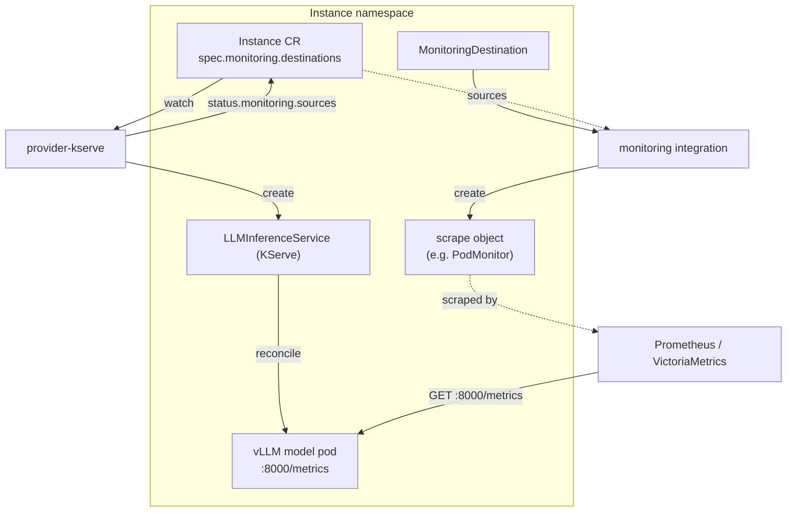
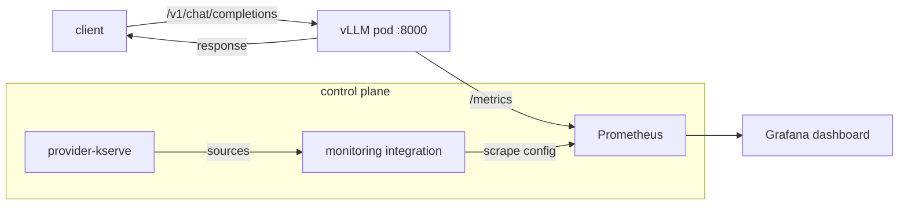

# Observability

> **New here?** Read [observability-overview.md](observability-overview.md) first
> for the mental model (provider vs Prometheus vs Grafana, vLLM vs gateway).

This provider makes its model workloads' metrics **discoverable** through
OpenEverest's monitoring contract. It ships **no** monitoring stack (no
Prometheus, no Grafana) and adds **no** metric-aggregation code: vLLM and the
KServe model servers already expose Prometheus metrics on a single endpoint, so
there is nothing to aggregate.

> **Not qpext.** KServe's [`qpext`](https://github.com/kserve/kserve/blob/master/qpext/README.md)
> extends the Knative **queue-proxy** sidecar to merge two containers' metrics
> onto one port. It only applies to Serverless/Knative mode. This provider runs
> everything in KServe's **Standard** mode (formerly `RawDeployment`) — one
> container per model pod, one `/metrics` endpoint — so `qpext` is irrelevant
> here.

## How it works

Monitoring backends are OpenEverest plugins. A monitoring integration (for
example [monitoring-prometheus](https://github.com/openeverest/monitoring-prometheus)
or [monitoring-victoriametrics](https://github.com/openeverest/monitoring-victoriametrics))
installs a `MonitoringClass`. A `MonitoringDestination` in the Instance's
namespace points at a backend, and the Instance lists the destinations it sends
metrics to:

```yaml
spec:
  monitoring:
    destinations:
      - {name: prometheus, destinationRef: {name: prometheus}}
```

The provider publishes each Instance's metrics endpoint in
`status.monitoring.sources.metrics`, and the integration behind the
destination's class creates the scrape objects (for example a `PodMonitor`):

- `llm`: vLLM's `:8000/metrics` on the decode and prefill workload pods.
- `predictor`: the port and path the serving runtime declares in its
  `prometheus.kserve.io/port` and `/path` annotations, which KServe copies onto
  the predictor pods (`:8080/metrics` for most runtimes, Triton `:8002`,
  TorchServe `:8082`). It is read from a predictor pod, so it is published
  once one exists.



Both component types serve their metrics natively (`metrics: Native` in
`definition/monitoring.yaml`), so binding a destination restarts nothing. The
component types declare the kinds `vllm` and `kserve-model-server`, which a
`MonitoringClass` can match.

## Enabling / disabling

Endpoints are published by default. Set `enableMetrics: false` in the topology
parameters (Observability → metrics toggle in the UI) to publish none, for
example for a custom container without a Prometheus endpoint.

To scrape with a tool OpenEverest does not configure (a hand-written
`PodMonitor`, Datadog, Alloy), set `spec.monitoring.sources.metrics.policy:
Always` and read the endpoints from the Instance status:

```bash
kubectl get instance <name> -o jsonpath='{.status.monitoring.sources.metrics}'
```

> **Upgrading from 0.5.x:** earlier releases created a `PodMonitor`
> (`<instance>-metrics`) per Instance, controlled by `metrics.podMonitor.enabled`.
> The provider now deletes it on the next reconcile. List a destination in
> `spec.monitoring.destinations` to keep collecting metrics.
> `metrics.podMonitor` now only controls the AI Gateway's PodMonitor.

## When no metrics show up

```bash
# 1. Is the endpoint published?
kubectl get instance <name> -n <ns> -o jsonpath='{.status.monitoring.sources.metrics}'

# 2. Is the destination bound and ready?
kubectl get instance <name> -n <ns> \
  -o jsonpath='{range .status.conditions[?(@.type=="MonitoringReady")]}{.status} {.reason}: {.message}{"\n"}{end}'

# 3. Does the pod actually serve metrics?
kubectl port-forward -n <ns> pod/<vllm-pod> 8000:8000
curl -s localhost:8000/metrics | grep '^vllm:' | head
```

## What metrics a vLLM pod gives you

vLLM exposes Prometheus metrics at `:8000/metrics`, all prefixed `vllm:`. These
are LLM-specific signals you cannot get from generic pod metrics.

| Metric | Type | What it tells you |
|---|---|---|
| `vllm:num_requests_running` | gauge | Requests actively decoding right now |
| `vllm:num_requests_waiting` | gauge | Queued requests (backlog) — scale-up signal |
| `vllm:gpu_cache_usage_perc` | gauge | KV-cache utilization (0–1); ~1.0 = memory-bound |
| `vllm:cpu_cache_usage_perc` | gauge | CPU KV-cache utilization (CPU serving) |
| `vllm:prefix_cache_hits_total` / `_queries_total` | counter | Prefix-cache effectiveness (matters for gateway/EPP routing) |
| `vllm:prompt_tokens_total` | counter | Input tokens processed — throughput & cost |
| `vllm:generation_tokens_total` | counter | Output tokens generated — throughput & cost |
| `vllm:time_to_first_token_seconds` | histogram | **TTFT** — perceived responsiveness |
| `vllm:time_per_output_token_seconds` | histogram | **TPOT / inter-token latency** — streaming smoothness |
| `vllm:e2e_request_latency_seconds` | histogram | Full request latency |
| `vllm:request_queue_time_seconds` | histogram | Time spent waiting before running |
| `vllm:request_prefill_time_seconds` / `_decode_time_seconds` | histogram | Prefill vs decode split (llm-d disaggregated path) |
| `vllm:request_success_total` | counter | Completions, labeled by `finished_reason` (stop/length) |
| `vllm:num_preemptions_total` | counter | Requests preempted under memory pressure (bad sign) |
| `vllm:iteration_tokens_total` | histogram | Tokens processed per engine step (batch efficiency) |
| `process_*`, `python_*` | — | Standard `prometheus_client` process metrics |

> Metric names track upstream vLLM and can shift slightly between versions.
> Confirm against a live pod with `curl localhost:8000/metrics | grep '^vllm:'`.

### Handy PromQL

```promql
# Output throughput (tokens/s)
sum(rate(vllm:generation_tokens_total[1m]))

# p95 time-to-first-token
histogram_quantile(0.95, sum(rate(vllm:time_to_first_token_seconds_bucket[5m])) by (le))

# Queue pressure
vllm:num_requests_waiting

# KV-cache saturation
vllm:gpu_cache_usage_perc
```

## Grafana dashboard

A ready-to-import dashboard lives at
[`docs/dashboards/vllm.json`](dashboards/vllm.json). Panels: token throughput,
running vs waiting requests, TTFT, TPOT, KV-cache usage, end-to-end latency, and
success/preemptions. It has `Namespace` and `Model` template variables (built
from the `namespace` and `model_name` labels).

**Import:** Grafana → Dashboards → New → Import → upload `vllm.json` → pick your
Prometheus data source.

**Provision via Helm (recommended for prod with kube-prometheus-stack):** enable
labeled dashboard ConfigMaps on the provider chart. The Grafana dashboard
sidecar (`grafana-sc-dashboard`) watches ConfigMaps with label
`grafana_dashboard=1` and auto-imports them:

```bash
helm upgrade --install provider-kserve ./charts/provider-kserve \
  --set metrics.grafanaDashboards.enabled=true \
  --set metrics.grafanaDashboards.namespace=monitoring
```

With AI Gateway, also set `aiGateway.enabled=true` (gateway dashboard is included
when `metrics.grafanaDashboards.gateway` is true, the default). Adjust
`metrics.grafanaDashboards.namespace` and label fields if your platform uses
different conventions.

**Provision manually** (same sidecar mechanism, without Helm):

```bash
kubectl create configmap vllm-dashboard \
  --from-file=vllm.json=docs/dashboards/vllm.json \
  -n monitoring \
  --dry-run=client -o yaml \
  | kubectl label -f - --local -o yaml grafana_dashboard=1 \
  | kubectl apply -f -
```

## Gateway (token / cost) metrics

When `aiGateway.enabled` is on, the chart also emits a singleton PodMonitor for
the Envoy AI Gateway's `gen_ai.*` metrics (per-model token/cost, TTFT, TPOT).
Details, PromQL, and the Grafana dashboard are in
[observability-gateway.md](observability-gateway.md).

## Whole architecture (data path)



The serving path (left) and the metrics path (right) are independent: metrics
scraping never sits in the request path, so it cannot add serving latency.
